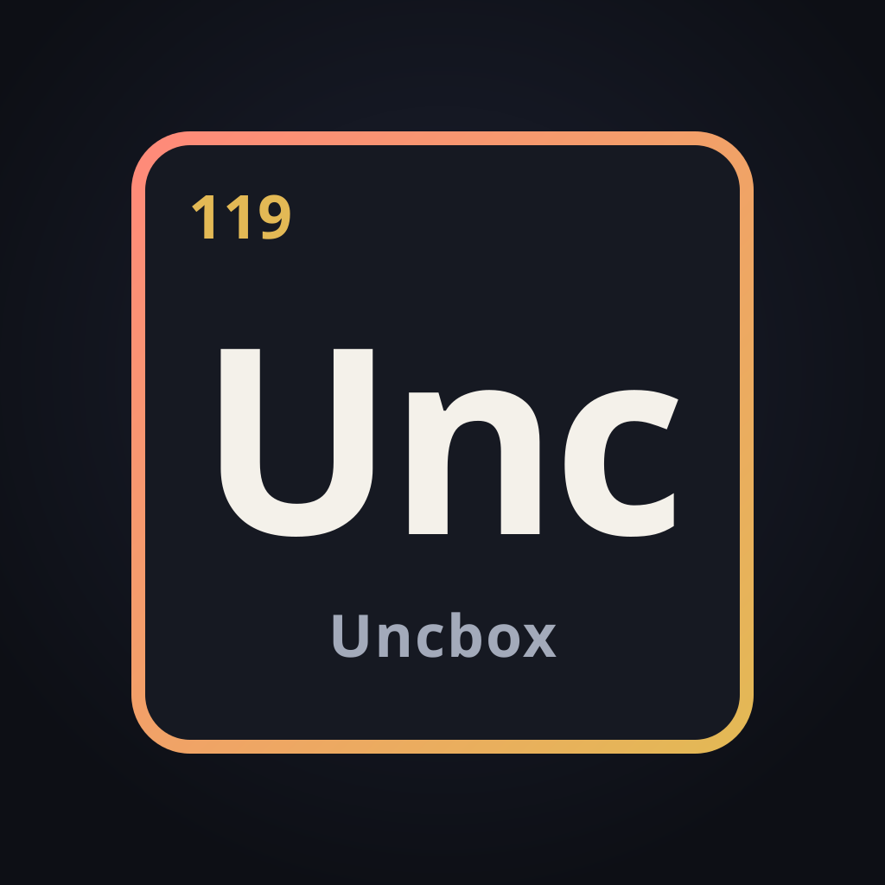
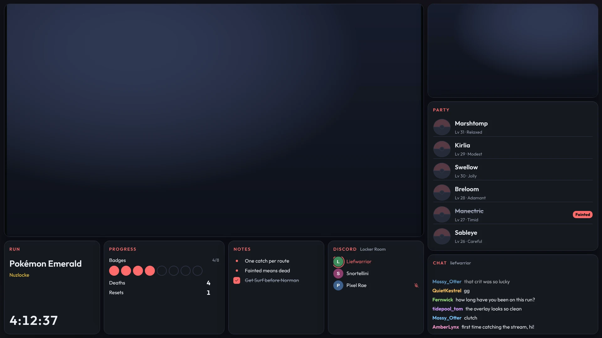
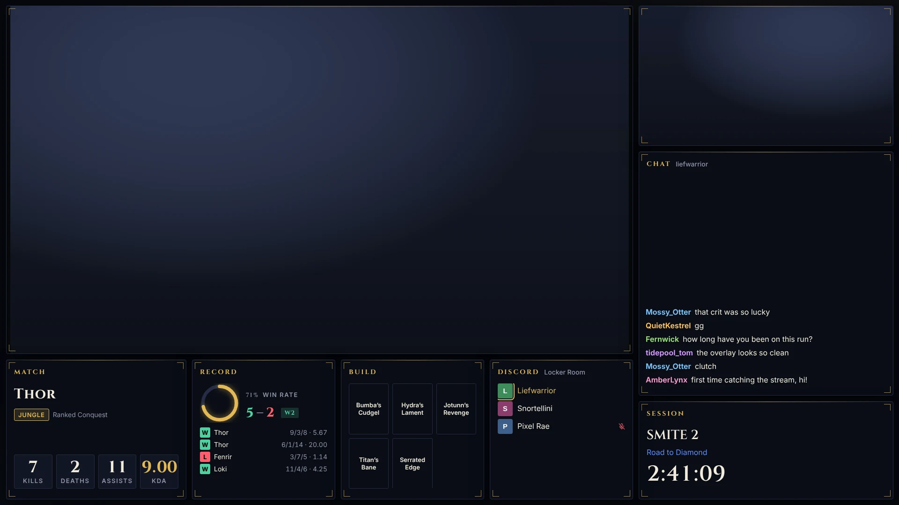
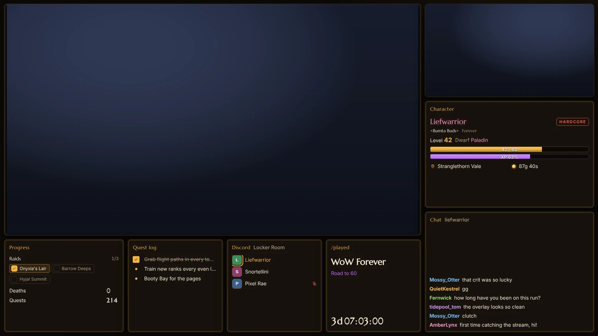
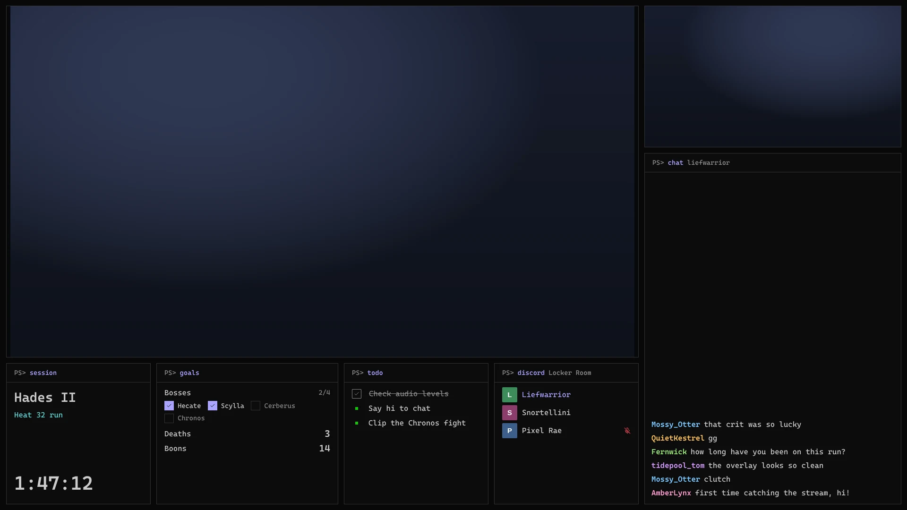
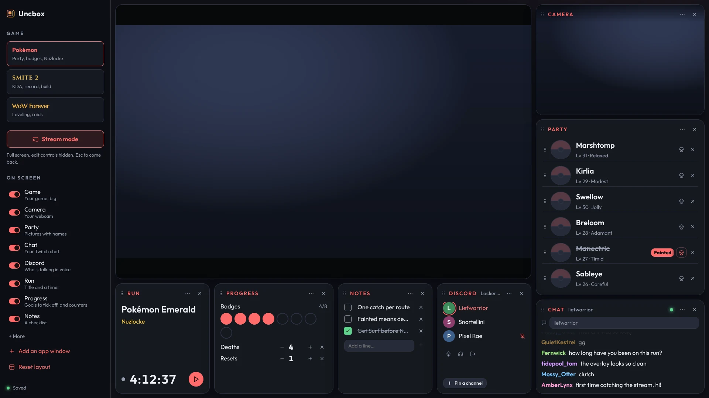

<div align="center">




[](https://www.buymeacoffee.com/liefwarrior)


</div>

## Presets

Note:  These are planned integrations, they may not work and may result in the sudden loss of DKP

<table>
  <tr>
    <td width="25%"></td>
    <td width="25%"></td>
    <td width="25%"></td>
    <td width="25%"></td>
  </tr>
  <tr>
    <td><b>Pokémon</b><br>Party with fainted markers, 8 badges, deaths and resets, run timer.</td>
    <td><b>SMITE 2</b><br>Live K/D/A, session record with win rate and streak, item build.</td>
    <td><b>WoW Forever</b><br>Character sheet with class color, level and XP, a live <a href="integrations/wow/README.md">quest log</a>, raids, /played.</td>
    <td><b>Terminal</b><br>Any game, dressed as PowerShell in Windows Terminal.</td>
  </tr>
</table>

Every panel works in every preset, so any game can borrow from the others. Each preset also picks
its own background in the sidebar: animated shapes or a pattern, drawn in the preset's colors.

## Get started

You need [Node.js](https://nodejs.org) 20 or newer, and Chrome or Edge.

```bash
npm install
npm start
```

Open <http://localhost:5170>. Want it at <https://unc.box> instead? Run `npm run setup-domain`
once (Windows asks for permission), then restart Uncbox. `npm run remove-domain` undoes it.

The **Get set up** list in the sidebar walks you through the rest:



1. **Pick your game** at the top of the sidebar.
2. **Show your game.** Choose a capture card (consoles), a window (emulators and PC games), or a
   green screen to key out in OBS.
3. **Turn on your camera**, **add your Twitch chat** and **connect Discord.** Click a step and
   Uncbox points at the panel that needs you. Not using one? Switch it off under **On screen**.
4. **Press Stream mode** (or `F8`). The window goes full screen and the edit controls hide.
   `Esc` brings everything back.

Something amazing just happened? Press **=** to save the last 60 seconds of your game as a clip.
See [Clips](#clips).

## The Uncbox app (Windows)

Rather run Uncbox as an app? `npm run app` opens it full screen, starts the server for you, and
keeps it in the tray when minimized. In the app, the game panel can **Play here**: your game's own
window moves into the panel, so you play it right inside the dashboard with mouse, keyboard or
controller, at its full frame rate. It needs the [.NET 10 SDK](https://dotnet.microsoft.com/download)
to build. See [native/README.md](native/README.md).

## Going live with OBS

1. Open Uncbox in its own window. In Edge: `start msedge --app=http://localhost:5170`
2. Press **Stream mode**.
3. In OBS, add a **Window Capture** of that window.
4. Using the green screen? Add a **Chroma Key** filter to that capture and put your game capture
   underneath.

Uncbox is video only. Capture game audio in OBS as usual.

## Guide

### Arranging the board

The board is a 24 × 24 grid that fills the window, so a layout looks the same at any size.

- **Move** a panel by dragging its title. **Resize** it from the right or bottom edge.
- **⋯** in a panel's title has its settings, all in plain words.
- **×** hides a panel. An **Undo** shows up for a few seconds, and **On screen** in the sidebar
  brings it back any time.
- **Reset layout** puts the preset's panels back where they started.

### The game window

Hover the game window for its toolbar.

| Source | Use it for | Good to know |
| --- | --- | --- |
| **Capture card** | Consoles | Most cards can only be open in one app. If OBS already has it, use the green screen. |
| **Window** | Emulators and PC games | The browser asks which window to show, again after every reload. |
| **Green screen** | Keeping your game capture in OBS | A flat color to key out, with the game layered underneath. Lowest delay. |

**Crop** trims menu bars and black borders. **Fit to game** sizes the window to the picture,
which removes the black bars around a GBA or DS screen. **Sharp pixels** keeps pixel art crisp.

### App windows

**Add an app window** shows any window on your PC (Spotify, a guide, a popped-out chat) in a
panel that matches the preset. Add as many as you like.

They are view only: a web page can show another window but can't click or type into it, and the
browser asks you to pick each window again after a reload.

### Clips

While your game is showing as a **Window** or **Capture card**, Uncbox keeps the last 60 seconds
of it. Press **=** (in the game, or anywhere) to save them as a clip: 1080p, 60 fps, H.264 High
profile at 30 Mbps, encoded on your graphics card. Clips go to `Videos\Uncbox`, and the newest
show under **Clips** in the sidebar, where clicking one plays it right in Uncbox.

- The key is read, not taken over: `=` still types in chat and other apps, and Shift+= (`+`)
  doesn't clip. Change it from **Key** in the sidebar, or switch instant replay off there.
- Clips have the same crop as the game window, so the WoW addon's strip and menu bars stay out.
- Video only, like the rest of Uncbox. Keeping the last minute takes about 225 MB of memory.
- `--clips=<folder>` saves them somewhere else.

### Twitch chat

Type your channel name into the chat panel. It connects anonymously and read-only, so there's
nothing to log in to. Bots like Nightbot and StreamElements are hidden; turn them back on from
the chat panel's **⋯**.

### Discord voice

The Discord panel shows who's in your voice channel and lights people up as they talk, with
mute and deafen in the preset's style. You can mute, deafen and leave from the panel, and pin
channels to join with one click. Audio still runs through the Discord app.

- **The built-in Uncbox app:** click **Connect Discord** and approve the prompt in Discord.
  Until Discord approves the app, only its listed App Testers can connect. See
  [docs/discord-rpc-approval.md](docs/discord-rpc-approval.md).
- **Your own app:** create a blank app at
  [discord.com/developers/applications](https://discord.com/developers/applications). Under
  OAuth2, turn on **Public Client** and add the redirect `http://localhost`, then paste its
  Application ID into the Discord panel. If the redirect is missing, the panel opens the right
  page and gives you the address to copy.

Sign-in uses PKCE, so no secret is needed or shipped. Tokens (and a secret, if you entered one)
stay in `data/discord.json` on your PC and never reach the browser.

### Driving it from another device

Every open copy stays in sync, so a phone can update counters while the captured window stays
clean. Uncbox only listens on your PC by default. To open it to your home network:

```powershell
$env:HOST = "0.0.0.0"; npm start
```

Then visit `http://<your-pc-ip>:5170`. There's no login, so only do this on a network you trust.
`--port=` and `--data=<folder>` change the port and where things are saved.

### Your data

Everything saves to `data/state.json` as you go. Saves from version 0.1 (PokéStream) move into
the Pokémon preset automatically.

## For developers

`npm run dev` runs with hot reload. Before a commit, `npm run check` runs the type check, a
syntax check of every server file, the tests and a production build.

```
server/index.mjs           static files, /api/state, live sync over /api/events
server/discord.mjs         Discord voice bridge over the local RPC pipe
server/open.mjs            opens setup pages in the default browser (fixed list only)
server/clips.mjs           saves and serves clips; server/hotkey.mjs watches the clip key
src/clips/                 instant replay: the encoder worker, its store, the clip keys
src/events.ts              the page's one live connection to /api/events
native/UncboxShell/        the Windows app, where the game can be played in its panel
                           (see native/README.md); src/native.ts is the page's side
src/panels/catalog.ts      every panel type: title, sidebar hint, default and minimum size
src/panels/index.tsx       which component draws each panel type
src/presets.ts             presets: titles, default layouts, starting data
src/state/                 saved state, loading and migration, the save/sync hook
src/components/            the board, the sidebar and one file per panel
src/styles.css             theme tokens and all styling
```

### Add a panel type

1. Add its id to `PANEL_IDS` in `src/state/model.ts`, and any data it keeps to `PresetData`
   (with a default in `baseData()` in `src/presets.ts`).
2. Give it a title, hint and size in `src/panels/catalog.ts`.
3. Write the component in `src/components/`, wrapped in `<Panel>`. Pass `empty` when it has
   nothing to show, and `menu` for its settings.
4. Map the id to the component in `src/panels/index.tsx`.

TypeScript flags any step you miss, and the sidebar lists the new panel on its own.

### Add a preset

1. Add an id to `PRESET_IDS` in `src/state/model.ts`.
2. Add its entry to `PRESETS` in `src/presets.ts`: name, one-line blurb, any renamed panel
   titles, a default layout and its starting data.
3. Add a `.theme-<id>` block of color, font and radius tokens at the top of `src/styles.css`,
   and a `.preset-card--<id> strong` rule so its sidebar card previews the font and color.

## Support

Uncbox is free. If it makes your stream better, you can
[buy me a coffee](https://www.buymeacoffee.com/liefwarrior).

Made by [Liefwarrior](https://github.com/Liefwarrior). Third-party licenses are in
[THIRD_PARTY_NOTICES.md](THIRD_PARTY_NOTICES.md); run `npm run notices` after changing
dependencies.
